<p align="center">
<picture>
  <source media="(prefers-color-scheme: dark)" srcset="assets/readme/banner-dark.svg">
  
</picture>
</p>

<p align="center">
  <a href="SETUP-GUIDE.pdf"><b>Setup guide (PDF)</b></a> &nbsp;·&nbsp;
  <a href="setup-code-slack.sh"><b>Setup script</b></a> &nbsp;·&nbsp;
  <a href="https://github.com/c3-oss/slack-mcp-server"><b>Upstream server</b></a>
</p>

<p align="center">
  
  
  
  
  
  
</p>

**Claude Code reads and posts in the CODE University Slack, as me.** Claude Code ↔ CODE University Slack
(codeuniversity.slack.com, malek.hassan@code.berlin) via [c3-oss/slack-mcp-server](https://github.com/c3-oss/slack-mcp-server),
browser-session auth, posting enabled.

There is no server code in this repo. It holds a setup script and a step-by-step guide. The server runs from npm
with `npx`, and it signs in with the tokens of your own Slack browser session, so no Slack app or admin approval
is needed.

<picture>
  <source media="(prefers-color-scheme: dark)" srcset="assets/readme/divider-dark.svg">
  
</picture>

## What you get

An MCP server named `slack-code`, registered at user scope, so every Claude Code project has it. It can read
channels, threads and DMs, search messages, list unreads, look up people, and post messages.

## What's in the repo

- `SETUP-GUIDE.pdf`: step-by-step token extraction + registration (redo when tokens expire)
- `setup-code-slack.sh`: prompts for xoxc + d cookie, verifies with Slack, registers `slack-code` (user scope)
- The server itself runs via `npx @c3-oss/slack-mcp-server@latest`; for reading its source,
  `git clone https://github.com/c3-oss/slack-mcp-server upstream-repo` (ignored here)
- Caches: `~/.cache/slack-mcp-code/` · Tokens: `~/.claude.json` (plain text, never commit)

## Setup

1. Follow `SETUP-GUIDE.pdf` to copy your `xoxc` token and `d` cookie from Slack in Chrome.
   The `xoxc` token comes from the DevTools console on app.slack.com; the `d` cookie (`xoxd-…`) is HttpOnly,
   so you copy it by hand from Application → Cookies.
2. `./setup-code-slack.sh`: paste both at the hidden prompts. It checks them with Slack's
   `auth.test` before registering, so a wrong paste fails loudly.
3. Restart Claude Code (or `/mcp`).

Check it from Terminal:

```sh
claude mcp get slack-code    # should say: Status: ✔ Connected
```

Redo 1–3 when Slack signs you out. This repo never contains tokens: they only live in
`~/.claude.json` on your Mac.

## What the script does

1. Reads the token and the cookie at hidden prompts and checks that they start with `xoxc-` and `xoxd-`.
2. Calls Slack's `auth.test` with both and stops if Slack rejects them.
3. Needs `npx` (Node.js), and creates `~/.cache/slack-mcp-code/`.
4. Removes any old `slack-code` entry, then registers the server:

```sh
claude mcp add slack-code -s user \
  -e SLACK_MCP_XOXC_TOKEN="$XOXC" \
  -e SLACK_MCP_XOXD_TOKEN="$XOXD" \
  -e SLACK_MCP_ADD_MESSAGE_TOOL=true \
  -e SLACK_MCP_USERS_CACHE="$HOME/.cache/slack-mcp-code/users.json" \
  -e SLACK_MCP_CHANNELS_CACHE="$HOME/.cache/slack-mcp-code/channels.json" \
  -- "$NPX" -y @c3-oss/slack-mcp-server@latest --transport stdio
```

The output of `claude mcp add` is filtered so the tokens are not echoed back.

## Troubleshooting

| Symptom | Fix |
| --- | --- |
| `SyntaxError … pasting` in the console | You typed `allow pasting` with no warning showing. Ignore it and paste the command. |
| `Cannot read properties of undefined` | Not on app.slack.com or not signed in. Open the workspace in the browser first. |
| Script: `Slack rejected these tokens` | The tokens are stale or mis-copied. Reload Slack and redo steps 1–2 of the guide. |
| `Status: Failed to connect` / timed out | The first run caches about 2,200 users and 930 channels (around 40 s). Run `/mcp` to reconnect after a minute. |
| You want posting off again | Delete the `SLACK_MCP_ADD_MESSAGE_TOOL=true` line from the script, then run it again. |

## Security

- The two tokens are your full Slack login. Never share them. To revoke them, sign out of Slack in Chrome,
  then redo the guide.
- Posting is on, so Claude can send messages as you. It should always ask you before sending.
- `upstream-repo/` is in `.gitignore`, so a local clone of the server's source never gets committed.

<picture>
  <source media="(prefers-color-scheme: dark)" srcset="assets/readme/divider-dark.svg">
  
</picture>

<p align="center">
  <br>
  <sub>Built by <a href="https://github.com/Malek1414">Malek Hassan</a> in Berlin.</sub>
</p>
